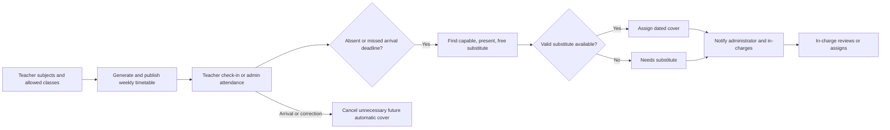

# Teacher-first timetable and daily cover

## One-time setup

1. Open **Teachers → teacher details → Teacher teaching setup**.
2. Choose capable subjects, allowed classes and preferred classes. The Montessori / Pre-primary shortcut selects the matching class names; review the list before saving.
3. Enable **Available for substitution when present and free** for teachers who may cover lessons.
4. Save the teacher setup once. Subjects and class eligibility save in the same transaction.
5. Assign the curriculum subjects to classes and activate their period timings. Timetable setup can choose teachers automatically from the profiles; preferred teacher selection is optional.
6. Generate sections together, review and publish the weekly timetables.

Main teaching allocations can still be entered on teacher details when a particular teacher should normally handle a subject. They remain preferences for generation; teacher capabilities, allowed classes, working times and workload are always checked.

## Daily operation

Teachers have a **Teacher check-in** button in the top bar. It records their own check-in only, using the school coverage timezone. Repeated check-ins preserve the first recorded arrival.

Administrators use **Teacher Attendance & Cover** to mark Present, Absent, Late, On leave or Permission. Late and Permission can include an expected arrival time. Attendance changes immediately reconcile dated cover. Administrators and in-charges can also use **Check attendance & cover** to refresh.

Missing-check-in detection is off until the administrator sets a deadline and enables it in **Automatic check-in and notification settings**. The configured default shown in the form is 09:15, Asia/Kolkata; review both values for the school. With detection enabled, a worker checks every minute while the backend is running. It skips non-working days, configured unavailable weekdays and school holidays/closures. Existing Present and On leave attendance is preserved. Administrative corrections remain authoritative; scheduled detection never overwrites a confirmed check-in. A Late/Permission record without an actual check-in is changed to Absent if its approved expected arrival time passes.

## Substitute selection

Only published lessons and supervised reserved periods receive date-specific cover. The selector checks:

- Teacher enabled for substitution.
- Subject capability for normal lessons.
- Allowed class.
- Confirmed presence/arrival by default.
- Teacher day/period availability.
- Overlap with ordinary lessons and other substitutions.
- Daily/weekly workload, including completed cover lessons.
- Mandatory consecutive/free-period limits.

Valid teachers are ranked deterministically by class preference and workload balance. Scores are suitability rankings, not probability estimates. If no valid teacher exists, the request remains **Needs substitute**. It never assigns a conflicting or unqualified teacher.

Teachers not yet confirmed present are excluded by default. A planned arrival time is not confirmation that a substitute has arrived. The in-charge can inspect rejection reasons and assign one of the currently eligible candidates with one click; availability is checked again inside a serializable transaction.

## Timetable and corrections

Weekly TimetableEntry records remain unchanged. A TimetableSubstitution stores the date-specific replacement, including supervised assembly/activity periods. **Timetables → Daily cover** displays the published schedule with those replacements.

Changing the main teacher to Present or recording their arrival cancels unnecessary upcoming automatic replacements. An ongoing lesson remains with its assigned substitute until the period ends. Completed cover remains in history; an uncovered period that has already ended is marked Missed. Manual assignments are preserved unless the substitute becomes unavailable or otherwise invalid, or the published timetable is replaced. Completed cover retains its lesson details even when an older weekly plan is archived.

## Notifications

The school administrators and selected active staff in-charges receive in-app notifications in the top bar. Messages include affected class, subject/time, assigned substitutes and unresolved requests. Repeating a background check does not create duplicate alerts. Corrected attendance updates the existing daily alert.

Recipients can read their own coverage alerts without receiving access to other people's attendance. Managing attendance requires ATTENDANCE_MARK and STAFF_UPDATE; assigning cover requires TIMETABLE_UPDATE; viewing the attendance desk requires ATTENDANCE_VIEW and STAFF_VIEW. Administrators can use Roles & Permissions to configure an in-charge's operational access. No permissions are automatically broadened.

This implementation sends in-app notifications. Email, SMS and biometric attendance integrations are separate services and are not configured here.

## API and storage

Existing StaffAttendance, TimetableSubstitution, Notification and Teacher models are reused. SchoolSetting.coveragePolicy stores deadline and notification settings. Teacher.timetableEligibility stores allowed/preferred classes and substitute opt-in. Migration 20261013120000_teacher_attendance_cover has been applied to local PostgreSQL.

- GET/PUT /api/v1/teacher-cover/policy
- GET /api/v1/teacher-cover?date=YYYY-MM-DD
- POST /api/v1/teacher-cover/refresh
- PUT /api/v1/teacher-cover/:id/assign
- GET /api/v1/teacher-cover/schedule?date=YYYY-MM-DD
- GET /api/v1/teacher-cover/alerts
- PATCH /api/v1/teacher-cover/alerts/:id/read
- GET/POST /api/v1/attendance/staff/check-in (authenticated active teacher, own staff record only)
- POST /api/v1/attendance/staff (administrative attendance correction)
- PUT /api/v1/teachers/:id/teaching-setup

The coverage integration test uses temporary PostgreSQL records inside a transaction that always rolls back. It verifies absence-triggered cover, private deduplicated notifications, a Present correction, timed missing-check-in detection and idempotent personal check-in while preserving weekly lesson records. Enable it with COVERAGE_DB_TEST=1; ordinary test runs skip database-backed fixtures.

## Operational flow

In-charges receive their own alerts without automatically gaining staff-record access. To manage the desk, configure Staff view and Attendance view; assigning cover also needs Timetable update. Correcting other teachers’ attendance needs Attendance mark and Staff update.
